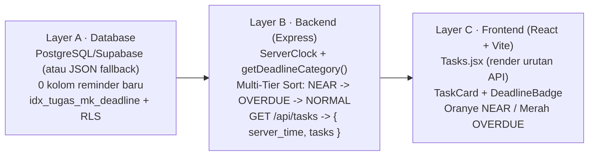

# StudyTrack — Reminder Tugas Mendekati Deadline

Implementasi kode nyata untuk studi kasus seleksi **Career Path Software Engineer — Academya Arkavidia 11.0 HMIF ITB (Kode: C-08 / SE)**, dibangun di atas starter kit resmi [`ZulfaNurhuda/StudyTrack`](https://github.com/ZulfaNurhuda/StudyTrack).

Fitur utama yang diimplementasikan adalah **Reminder Tugas Mendekati Deadline (F01–F04)** secara konsisten lintas 3 layer (**Database → Backend → Frontend**) beserta pengujian otomatis 5 skenario verifikasi, migrasi PostgreSQL/Supabase ber-RLS, GitHub Actions CI, dan konfigurasi siap deploy ke **Supabase + Render + Vercel**.

---

## Ringkasan Kebutuhan Fitur (F01–F04)

| Kode | Kebutuhan | Implementasi |
| :--- | :--- | :--- |
| **F01** | Tugas dikategorikan mendekati deadline jika sisa waktu `< 24 jam` (tetap) | `0 < (deadline - now) < 86400` detik untuk tugas berstatus `belum` → `NEAR` |
| **F02** | Tugas mendekati deadline wajib tampil di urutan paling atas + penanda visual jelas | Multi-Tier Sorting menempatkan `NEAR` di prioritas `#1` + border/badge oranye `#D97706` |
| **F03** | Tugas melewati deadline (*overdue*) tetap tampil dengan visual berbeda dari `NEAR` | `deadline - now <= 0` → `OVERDUE` di prioritas `#2` + border/badge merah `#DC2626` |
| **F04** | Berlaku untuk seluruh tugas milik mahasiswa login lintas semua mata kuliah | Query `JOIN` terisolasi `WHERE t.user_id = $1` + index `idx_tugas_mk_deadline` & `idx_tasks_user_deadline` |

---

## Ringkasan Framework 3P & Arsitektur 3-Layer

### Langkah P1–P3 (7 Task Teknis)

| Task | Layer | Deskripsi | Ketergantungan |
| :--- | :--- | :--- | :--- |
| **Task 01** | Database | Skema relasional tanpa kolom reminder baru + composite index `idx_tugas_mk_deadline` & RLS | — |
| **Task 02** | Backend | Fungsi murni `getDeadlineCategory(deadline, status, now)` (`< 24 jam` eksklusif; `selesai` → `NORMAL`) | — |
| **Task 03** | Backend | `enrichAndSortTasks()` dengan Multi-Tier Sort (`NEAR #1 → OVERDUE #2 → NORMAL #3`) | Task 01, 02 |
| **Task 04** | Backend | Integrasi `ServerClock` pada `GET /api/tasks` → `{ server_time, tasks }` + `GET /api/health` | Task 02, 03 |
| **Task 05** | Frontend | Komponen deklaratif `DeadlineBadge` & gaya border kontekstual `TaskCard` (status `Belum`/`Selesai` tetap utuh) | — |
| **Task 06** | Frontend | Integrasi `Tasks.jsx` (tanpa client-side re-sort) + ringkasan hitung & auto-refresh 5 menit / `visibilitychange` | Task 04, 05 |
| **Task 07** | BE & FE | Suite pengujian otomatis 5 skenario studi kasus + boundary + isolasi tenant HTTP | Task 06 |

### Alur Data End-to-End



---

## Keputusan Arsitektur per Layer

### Layer A — Database (`supabase/migrations/001_initial_studytrack_schema.sql` & `backend/db.js`)

- **0 Kolom Reminder Baru:** Status `NEAR` / `OVERDUE` adalah *time-dependent derived state* yang berubah tiap detik. Menyimpannya sebagai kolom statis berisiko *stale data* dan memaksa beban cron job, sedangkan kolom `deadline` dan `status` sudah menjadi *Single Source of Truth*.
- **Optimasi Query & Keamanan Supabase:**
  - Composite index `idx_tugas_mk_deadline (mata_kuliah_id, deadline)` dan `idx_tasks_user_deadline (user_id, deadline)`.
  - `ENABLE ROW LEVEL SECURITY` aktif pada seluruh tabel publik (`users`, `courses`, `tasks`) dengan policy isolasi tenant serta pencabutan akses `anon`.
- **Dual-Mode Adapter (`backend/db.js`):** Otomatis memakai `pg.Pool` (SSL siap Supabase) bila `DATABASE_URL` diisi, dan fallback mulus ke `backend/db.json` bila kosong untuk development/CI tanpa rahasia.

### Layer B — Backend (`backend/utils/deadline.js`, `backend/routes/tasks.js`, `backend/server.js`)

- `TWENTY_FOUR_HOURS_SEC = 86400`, `PRIORITY = { NEAR: 1, OVERDUE: 2, NORMAL: 3 }`.
- Aturan `getDeadlineCategory(deadlineStr, status, now)`:
  - `status === 'selesai'` → `'NORMAL'`
  - `0 < diffSeconds < 86400` → `'NEAR'` (tepat `86400s` = `'NORMAL'`)
  - `diffSeconds <= 0` → `'OVERDUE'`
  - Lainnya → `'NORMAL'`
- **Multi-Tier Sorting:** `PRIORITY ASC`, lalu untuk `NEAR` dan `OVERDUE` diurutkan `deadline ASC` (paling mendesak di atas), sedangkan `NORMAL` mempertahankan `created_at DESC`.
- Endpoint `GET /api/health` mengembalikan `{ status: "ok", storage: "postgres" | "json", timestamp }`.

### Layer C — Frontend (`frontend/src/components/DeadlineBadge.jsx`, `TaskCard.jsx`, `Tasks.jsx`)

- `DeadlineBadge` merender deklaratif berdasarkan `task.deadline_category` & `task.remaining_seconds`/`remaining_hours`:
  - `NEAR` → Badge oranye `⏰ Mendekati Deadline (< 24 Jam)` + sisa waktu (`Sisa 23j 59m`) + kartu krem hangat `#FFFBEB` border `#D97706`.
  - `OVERDUE` → Badge merah `⚠️ Terlambat / Overdue` + durasi terlewat (`Terlewat 14j`) + kartu rose `#FFF5F5` border `#DC2626`.
  - `NORMAL` → Tanpa warning badge (kartu netral).
- Badge status eksisting (`Belum` kuning / `Selesai` hijau) tetap dipertahankan.
- Halaman `Tasks` menampilkan strip ringkasan jumlah kategori dan menyegarkan daftar otomatis tiap 5 menit serta saat tab kembali aktif (`visibilitychange`).

---

## Verifikasi Otomatis (Tugas 3 — 5 Skenario + Integration Tests)

Menjalankan seluruh 11 pengujian (menggunakan native `node:test`, tanpa dependensi test tambahan):

```bash
cd backend
npm test
```

Cakupan utama pada `backend/tests/deadline.test.js`:
1. **Skenario 1 (Positif F01/F02/F04):** Seed ID 1 (`Lab 4`, `2026-07-03T23:59:00`, `belum`) pada `2026-07-03T00:00:00` → `NEAR`, urutan `#1`.
2. **Skenario 2 (Positif F03):** Seed ID 2 (`Project 3`, `2026-07-02T10:00:00`, `belum`) → `OVERDUE`, urutan `#2` (`-14` jam).
3. **Skenario 3 (Negatif ≥ 24 jam):** Seed ID 3 (`Sprint 2`, `2026-07-06T23:59:00`, `belum`) → `NORMAL`, urutan `#3` (urutan penuh `[1, 2, 3]`).
4. **Skenario 4 (Edge Case tepat 24 jam):** Pada `2026-07-02T23:59:00` (`86400s`) → `NORMAL`; 1 detik kemudian `23:59:01` (`86399s`) → `NEAR` dan naik ke `#1`.
5. **Skenario 5 (Edge Case status selesai):** ID 1 (`< 24 jam`) diubah ke `'selesai'` → `NORMAL`, turun di bawah tugas aktif `OVERDUE`.
6. **Uji Tambahan:** Tie-breaking `deadline ASC` / `created_at DESC`, batas tepat `0s`, konsistensi parsing `datetime-local` vs ISO UTC, serta uji HTTP Express langsung (`/api/health`, `/api/auth/*`, `/api/tasks`, dan isolasi multi-tenant F04).

---

## Cara Menjalankan Lokal

### Prasyarat
- Node.js `>= 20.19` atau `>= 22.12` (diuji pada Node `22.18.0`)

### 1. Backend
```bash
cd backend
cp .env.example .env
npm install
npm run dev
```
- **Mode JSON (default):** Tidak perlu mengisi `DATABASE_URL`; `backend/db.json` dibuat otomatis dengan akun demo `demo@studytrack.test` / `demo1234`.
- **Mode PostgreSQL / Supabase:** Isi `DATABASE_URL` di `backend/.env`, lalu jalankan:
  ```bash
  npm run db:migrate
  npm run db:seed
  ```

### 2. Frontend
```bash
cd frontend
npm install
npm run dev
```
Buka `http://localhost:5173` dan login dengan `demo@studytrack.test` / `demo1234`.

---

## Panduan Deployment Produksi (Supabase + Render + Vercel)

1. **Database (Supabase):**
   - Buat project Supabase baru → salin Connection String PostgreSQL (`DATABASE_URL`, disarankan Session/Transaction Pooler port `5432`/`6543` dengan SSL).
   - Jalankan `supabase/migrations/001_initial_studytrack_schema.sql` lewat Supabase SQL Editor atau `DATABASE_URL="..." npm run db:migrate && npm run db:seed`.
2. **Backend (Render):**
   - Hubungkan repositori GitHub menggunakan Blueprint [`render.yaml`](./render.yaml) (Root Dir: `backend`, Health Check: `/api/health`).
   - Isi environment variables: `DATABASE_URL`, `JWT_SECRET` (string acak 32+ karakter), dan `FRONTEND_URL` (URL Vercel frontend).
3. **Frontend (Vercel):**
   - Import repositori GitHub dengan **Root Directory = `frontend`** (SPA rewrite sudah siap di [`frontend/vercel.json`](./frontend/vercel.json)).
   - Isi environment variable `VITE_API_URL=https://<nama-service-render>.onrender.com/api`.
4. **CI (GitHub Actions):**
   - Workflow [`.github/workflows/ci.yml`](./.github/workflows/ci.yml) otomatis menjalankan sintaks check, 11 test backend, validasi SQL migration, dan production build Vite pada setiap push/PR ke `main`.
