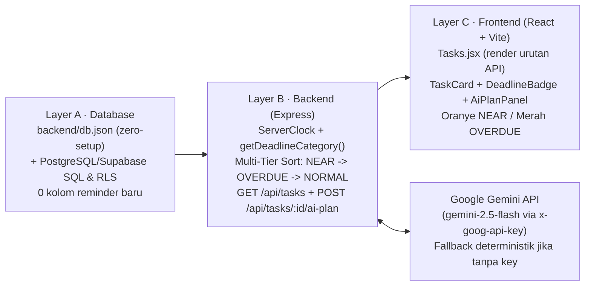

# StudyTrack — Reminder Tugas Mendekati Deadline & AI Action Plan

Implementasi kode nyata untuk studi kasus seleksi **Career Path Software Engineer — Academya Arkavidia 11.0 HMIF ITB (Kode: C-08 / SE)**, dibangun di atas starter kit resmi [`ZulfaNurhuda/StudyTrack`](https://github.com/ZulfaNurhuda/StudyTrack).

Fitur utama yang diimplementasikan adalah **Reminder Tugas Mendekati Deadline (F01–F04)** secara konsisten lintas 3 layer (**Database → Backend → Frontend**), dilengkapi 3 nilai tambah terverifikasi:

1. **Implementasi Kode Nyata 3-Layer:** 100% langsung berjalan secara lokal dalam 2 perintah (`npm run dev` pada backend & frontend memakai `backend/db.json` tanpa setup eksternal), sekaligus menyediakan skema SQL PostgreSQL/Supabase ber-RLS & adapter dual-mode `pg`.
2. **Pemanfaatan AI/LLM API (`Google Gemini API`):** Fitur **✨ Rencana Kerja AI** (`POST /api/tasks/:id/ai-plan`) yang menyusun strategi pengerjaan taktis berbasis kategori deadline (`NEAR` / `OVERDUE` / `NORMAL`) dengan *graceful deterministic fallback* (`Mode Panduan Lokal`) bila `GEMINI_API_KEY` belum diisi atau layanan upstream tidak tersedia.
3. **Git History Rapi & GitHub Actions CI:** 6 feature branches dengan Conventional Commits serta workflow CI otomatis ([`.github/workflows/ci.yml`](./.github/workflows/ci.yml)) untuk sintaks check, 15 pengujian backend, validasi SQL migration, dan production build Vite.

---

## Ringkasan Kebutuhan Fitur (F01–F04)

| Kode | Kebutuhan | Implementasi |
| :--- | :--- | :--- |
| **F01** | Tugas dikategorikan mendekati deadline jika sisa waktu `< 24 jam` (tetap) | `0 < (deadline - now) < 86400` detik untuk tugas berstatus `belum` → `NEAR` |
| **F02** | Tugas mendekati deadline wajib tampil di urutan paling atas + penanda visual jelas | Multi-Tier Sorting menempatkan `NEAR` di prioritas `#1` + border/badge oranye `#D97706` |
| **F03** | Tugas melewati deadline (*overdue*) tetap tampil dengan visual berbeda dari `NEAR` | `deadline - now <= 0` → `OVERDUE` di prioritas `#2` + border/badge merah `#DC2626` |
| **F04** | Berlaku untuk seluruh tugas milik mahasiswa login lintas semua mata kuliah | Query `JOIN` terisolasi `WHERE t.user_id = $1` + index `idx_tugas_mk_deadline` & `idx_tasks_user_deadline` |

---

## Ringkasan Framework 3P & Arsitektur 3-Layer

### Langkah P1–P3 (7 Task Teknis + Ekstensi AI Action Plan)

| Task | Layer | Deskripsi | Ketergantungan |
| :--- | :--- | :--- | :--- |
| **Task 01** | Database | Skema relasional tanpa kolom reminder baru + composite index `idx_tugas_mk_deadline` & RLS | — |
| **Task 02** | Backend | Fungsi murni `getDeadlineCategory(deadline, status, now)` (`< 24 jam` eksklusif; `selesai` → `NORMAL`) | — |
| **Task 03** | Backend | `enrichAndSortTasks()` dengan Multi-Tier Sort (`NEAR #1 → OVERDUE #2 → NORMAL #3`) | Task 01, 02 |
| **Task 04** | Backend | Integrasi `ServerClock` pada `GET /api/tasks` → `{ server_time, tasks }` + `GET /api/health` | Task 02, 03 |
| **Task 05** | Frontend | Komponen deklaratif `DeadlineBadge` & gaya border kontekstual `TaskCard` (status `Belum`/`Selesai` tetap utuh) | — |
| **Task 06** | Frontend | Integrasi `Tasks.jsx` (tanpa client-side re-sort) + ringkasan hitung & auto-refresh 5 menit / `visibilitychange` | Task 04, 05 |
| **Task 07** | BE & FE | Suite pengujian otomatis 5 skenario studi kasus + boundary + isolasi tenant HTTP | Task 06 |
| **Bonus AI** | BE & FE | `backend/services/aiPlanner.js` + `POST /api/tasks/:id/ai-plan` (Gemini API + fallback) + `AiPlanPanel.jsx` | Task 04, 05 |

### Alur Data End-to-End



---

## Keputusan Arsitektur per Layer

### Layer A — Database (`supabase/migrations/001_initial_studytrack_schema.sql` & `backend/db.js`)

- **0 Kolom Reminder Baru:** Status `NEAR` / `OVERDUE` adalah *time-dependent derived state* yang berubah tiap detik. Menyimpannya sebagai kolom statis berisiko *stale data* dan memaksa beban cron job, sedangkan kolom `deadline` dan `status` sudah menjadi *Single Source of Truth*.
- **Optimasi Query & Keamanan SQL:**
  - Composite index `idx_tugas_mk_deadline (mata_kuliah_id, deadline)` dan `idx_tasks_user_deadline (user_id, deadline)`.
  - `ENABLE ROW LEVEL SECURITY` aktif pada seluruh tabel publik (`users`, `courses`, `tasks`) dengan policy isolasi tenant serta pencabutan akses `anon`.
- **Dual-Mode Adapter (`backend/db.js`):** Berjalan langsung secara lokal dengan `backend/db.json` tanpa setup apa pun, dan otomatis beralih ke `pg.Pool` (PostgreSQL/Supabase) apabila `DATABASE_URL` diisi.

### Layer B — Backend (`backend/utils/deadline.js`, `backend/services/aiPlanner.js`, `backend/routes/tasks.js`)

- `TWENTY_FOUR_HOURS_SEC = 86400`, `PRIORITY = { NEAR: 1, OVERDUE: 2, NORMAL: 3 }`.
- Aturan `getDeadlineCategory(deadlineStr, status, now)`:
  - `status === 'selesai'` → `'NORMAL'`
  - `0 < diffSeconds < 86400` → `'NEAR'` (tepat `86400s` = `'NORMAL'`)
  - `diffSeconds <= 0` → `'OVERDUE'`
  - Lainnya → `'NORMAL'`
- **Multi-Tier Sorting:** `PRIORITY ASC`, lalu untuk `NEAR` dan `OVERDUE` diurutkan `deadline ASC` (paling mendesak di atas), sedangkan `NORMAL` mempertahankan `created_at DESC`.
- Endpoint `GET /api/health` mengembalikan `{ status: "ok", storage: "postgres" | "json", timestamp }`.

### Fitur AI/LLM API — AI Action Plan (`POST /api/tasks/:id/ai-plan`)

- **Autentikasi & Anti-IDOR:** Endpoint diproteksi `requireAuth` (`401` tanpa token valid) dan memverifikasi kepemilikan tugas via `findTaskByIdForUser(taskId, req.user.id)` (`404` bila tugas milik user lain atau tidak ada).
- **Integrasi Google Gemini API Tanpa Bloat Dependency:** Menggunakan native `fetch` Node.js 22 ke `https://generativelanguage.googleapis.com/v1beta/models/${GEMINI_MODEL}:generateContent` dengan header `x-goog-api-key` (API key tidak pernah diletakkan di URL query), `responseMimeType: "application/json"`, `temperature: 0.3`, dan timeout `8000ms` via `AbortSignal.timeout(8000)`.
- **Kontrak Respons Tervalidasi:**
  ```json
  {
    "server_time": "2026-07-03T00:00:00.000Z",
    "plan": {
      "task_id": 1,
      "deadline_category": "NEAR",
      "remaining_hours": 23.98,
      "source": "gemini",
      "model": "gemini-2.5-flash",
      "urgency_summary": "...",
      "estimated_total_minutes": 90,
      "first_action_now": "...",
      "steps": [
        { "step": "...", "duration_minutes": 25, "tip": "..." }
      ]
    }
  }
  ```
- **Graceful Deterministic Fallback:** Jika `GEMINI_API_KEY` belum diisi (`fallback_reason: "missing_api_key"`) atau upstream Gemini gagal/timeout/mengembalikan JSON tidak valid (`fallback_reason: "api_unavailable"`), layanan tetap mengembalikan rencana kerja terstruktur dalam Bahasa Indonesia sesuai kategori `NEAR` / `OVERDUE` / `NORMAL` dengan `source: "fallback"`.

### Layer C — Frontend (`frontend/src/components/DeadlineBadge.jsx`, `AiPlanPanel.jsx`, `TaskCard.jsx`, `Tasks.jsx`)

- `DeadlineBadge` merender deklaratif berdasarkan `task.deadline_category` & `task.remaining_seconds`/`remaining_hours`:
  - `NEAR` → Badge oranye `⏰ Mendekati Deadline (< 24 Jam)` + sisa waktu (`Sisa 23j 59m`) + kartu krem hangat `#FFFBEB` border `#D97706`.
  - `OVERDUE` → Badge merah `⚠️ Terlambat / Overdue` + durasi terlewat (`Terlewat 14j`) + kartu rose `#FFF5F5` border `#DC2626`.
  - `NORMAL` → Tanpa warning badge (kartu netral).
- Tombol **`✨ Rencana Kerja AI`** tampil di setiap kartu tugas berstatus `belum` (menonjol pada `NEAR` dan `OVERDUE`, halus pada `NORMAL`) dan membuka panel inline `AiPlanPanel` lengkap dengan lencana sumber (`Gemini AI` / `Mode Panduan Lokal`), estimasi durasi, kotak sorotan **Mulai 5 Menit Pertama**, dan checklist langkah interaktif.
- Badge status eksisting (`Belum` kuning / `Selesai` hijau) tetap dipertahankan, dan halaman `Tasks` menyegarkan daftar otomatis tiap 5 menit serta saat tab kembali aktif (`visibilitychange`).

---

## Verifikasi Otomatis (15 Test — Deadline + AI Planner + HTTP Integration)

Menjalankan seluruh 15 pengujian menggunakan native `node:test` (tanpa dependensi test eksternal):

```bash
cd backend
npm test
```

Cakupan pengujian:
- **`backend/tests/deadline.test.js` (11 test):**
  1. **Skenario 1 (Positif F01/F02/F04):** Seed ID 1 (`Lab 4`, `2026-07-03T23:59:00`, `belum`) pada `2026-07-03T00:00:00` → `NEAR`, urutan `#1`.
  2. **Skenario 2 (Positif F03):** Seed ID 2 (`Project 3`, `2026-07-02T10:00:00`, `belum`) → `OVERDUE`, urutan `#2` (`-14` jam).
  3. **Skenario 3 (Negatif ≥ 24 jam):** Seed ID 3 (`Sprint 2`, `2026-07-06T23:59:00`, `belum`) → `NORMAL`, urutan `#3` (urutan penuh `[1, 2, 3]`).
  4. **Skenario 4 (Edge Case tepat 24 jam):** Pada `2026-07-02T23:59:00` (`86400s`) → `NORMAL`; 1 detik kemudian `23:59:01` (`86399s`) → `NEAR` dan naik ke `#1`.
  5. **Skenario 5 (Edge Case status selesai):** ID 1 (`< 24 jam`) diubah ke `'selesai'` → `NORMAL`, turun di bawah tugas aktif `OVERDUE`.
  6. **Uji Tambahan:** Tie-breaking `deadline ASC` / `created_at DESC`, batas tepat `0s`, konsistensi parsing `datetime-local` vs ISO UTC, serta uji HTTP Express langsung (`/api/health`, `/api/auth/*`, `/api/tasks`, dan isolasi multi-tenant F04).
- **`backend/tests/aiPlanner.test.js` (4 test):**
  1. **Live Gemini Happy Path (Mock `fetchImpl`):** Memastikan API key dikirim lewat header `x-goog-api-key` (tidak bocor di URL) dan normalisasi output `source: "gemini"`.
  2. **Deterministic Fallback (`missing_api_key`):** Memastikan nol panggilan jaringan dan panduan kontekstual berbeda untuk `NEAR`, `OVERDUE`, dan `NORMAL`.
  3. **Upstream Failure Degradation (`api_unavailable`):** Memastikan HTTP 500, JSON rusak, skema tidak valid, dan galat jaringan tetap jatuh mulus ke panduan lokal.
  4. **HTTP Integration `POST /api/tasks/:id/ai-plan`:** Memastikan autentikasi wajib (`401`), blokir lintas user anti-IDOR (`404`), validasi ID (`400`), dan respons `200 { server_time, plan }` untuk pemilik tugas.

---

## Cara Menjalankan Lokal (Zero-Setup dalam 2 Perintah)

### Prasyarat
- Node.js `>= 20.19` atau `>= 22.12` (diuji pada Node `22.18.0`)

### 1. Backend
```bash
cd backend
cp .env.example .env
npm install
npm run dev
```
- **Mode JSON (default, siap pakai):** Tidak perlu mengisi `DATABASE_URL`; `backend/db.json` dibuat otomatis dengan akun demo `demo@studytrack.test` / `demo1234`.
- **Mode AI Langsung (opsional):** Isi `GEMINI_API_KEY=<api-key-anda>` (dan opsional `GEMINI_MODEL=gemini-2.5-flash`) di `backend/.env` untuk mengaktifkan respons langsung Google Gemini API. Jika dikosongkan, tombol **✨ Rencana Kerja AI** tetap bekerja mulus dalam **Mode Panduan Lokal**.
- **Mode PostgreSQL / Supabase (opsional):** Isi `DATABASE_URL` di `backend/.env`, lalu jalankan:
  ```bash
  npm run db:migrate
  npm run db:seed
  ```

### 2. Frontend
```bash
cd frontend
npm install
npm run dev
```
Buka `http://localhost:5173`, login dengan `demo@studytrack.test` / `demo1234`, lalu klik **`✨ Rencana Kerja AI`** pada kartu tugas mana pun yang berstatus `Belum`.

---

## Git History & Continuous Integration

- Seluruh pengembangan dikerjakan dalam 6 feature branches terpisah (`feat/database-supabase-migration`, `feat/backend-deadline-reminder`, `feat/frontend-deadline-badges`, `test/deadline-verification-suite`, `ci/github-actions-and-deploy`, `feat/ai-study-planner`) dengan Conventional Commits dan merge non-fast-forward yang bersih ke `main`.
- Workflow [`.github/workflows/ci.yml`](./.github/workflows/ci.yml) berjalan otomatis pada setiap push/PR ke `main` dengan `permissions: contents: read`, memeriksa sintaks seluruh berkas backend (termasuk `services/*.js`), menjalankan seluruh 15 test backend, memvalidasi guardrail migrasi SQL (0 kolom reminder baru + index + RLS), serta memverifikasi production build Vite & aturan nol komentar CSS.
